# EMShrimulator Studio

A desktop app for [openEMS](https://openems.de) on Fedora Linux and Windows, so you can run EM
simulations without writing scripts.

openEMS is a really good free FDTD solver, but you drive it from Python or
MATLAB. I wanted the workflow I was used to from commercial tools: draw a model
or load a PCB, put ports on it, set a sweep, hit Run, then look at S-parameters
and radiation patterns. This is that.

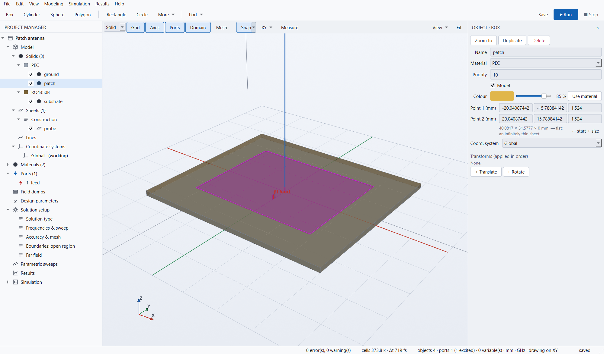

## What's in it

There are two kinds of project.

**3D Modeler.** You build the geometry yourself: boxes, cylinders, spheres,
polygons, sheets, wires, and booleans between them. Any dimension can be a
variable or an expression like `Wp/2 + 40mil`, and any variable can be swept.
Ports go on sheets (lumped, microstrip, waveguide or coax). You also get
snapping, a measure tool, local coordinate systems, a mesh preview, and the
usual setup: frequency sweep, adaptive passes, open region, far field and
wideband dielectric loss.

**3D Layout.** Import a board from Gerber/Excellon (a zip or loose files) or
ODB++, set up the stackup, click on copper to place ports, and run. You can
colour copper by net, define differential pairs and get mixed-mode
S-parameters, edit traces and pads, and set up padstacks and vias (blind,
buried, backdrilled). Under the hood the board goes through a patched copy of
Antmicro's [gerber2ems](https://github.com/antmicro/gerber2ems).

Both end up in the same place: **Results › New report**. You can plot S, Y and
Z parameters, VSWR, impedance, group delay, TDR, gain, directivity and axial
ratio in any polarisation, and near fields. Pick a rectangular plot, polar,
Smith chart, contour, 3D pattern, pattern drawn over the model, or a plain
table. You can mix different kinds of trace on one graph. Everything exports
to CSV, and S-parameters to Touchstone.

The modeler comes with templates that run as they are: patch antennas, a
coax-fed patch, a half-wave dipole, a microstrip line, a WR-90 waveguide, a
coax line, an iris-coupled cavity and a Wilkinson divider. The layout side
comes with gerber2ems's example boards.

| | |
| --- | --- |
| 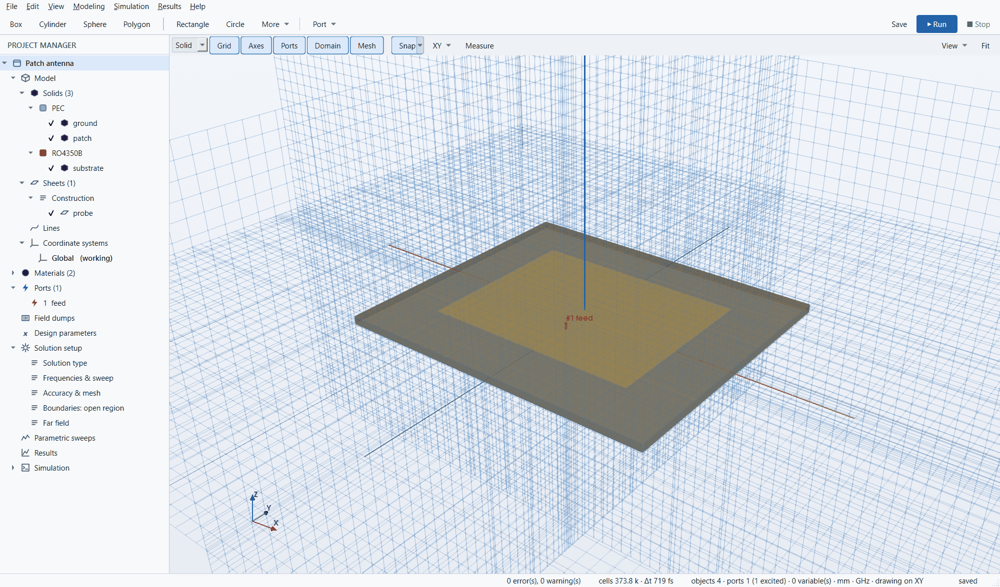 | 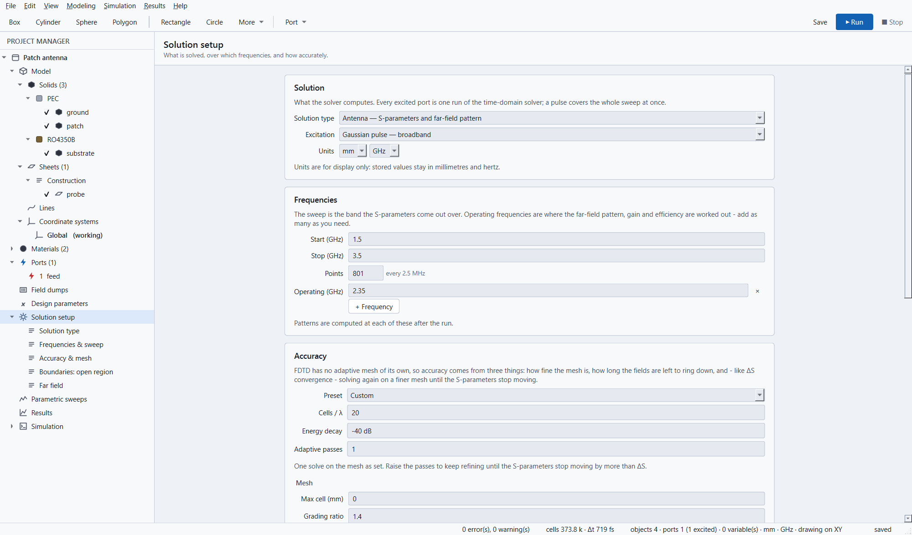 |
| Mesh preview | Solution setup |
| 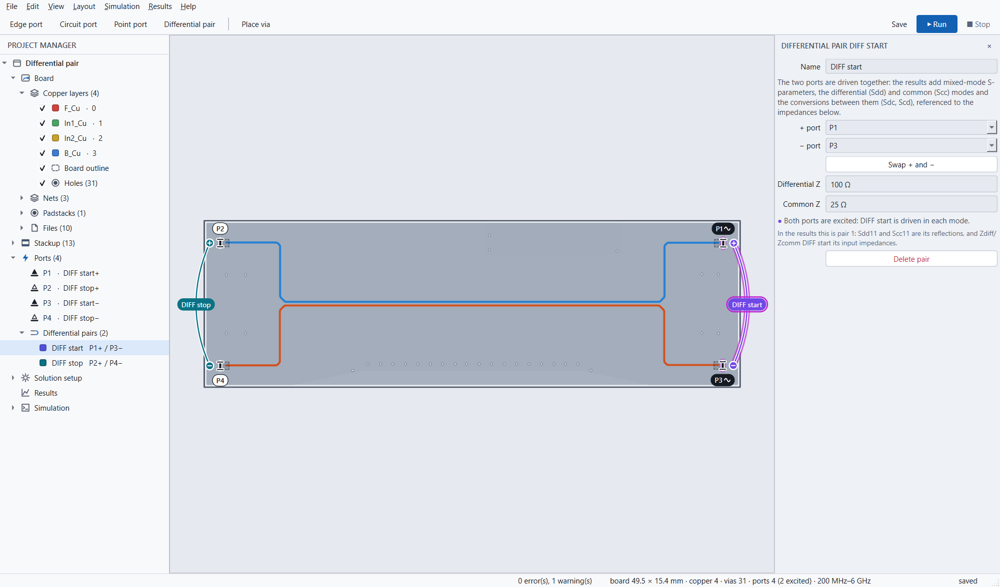 | 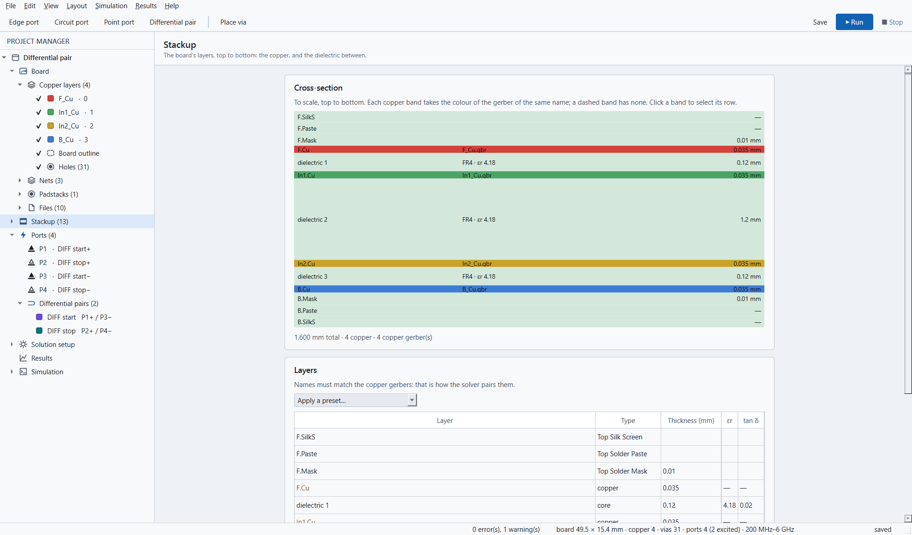 |
| Differential pair, coloured by net | Stackup editor |
| 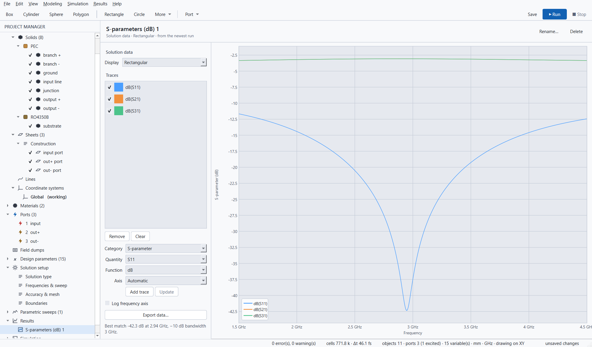 | 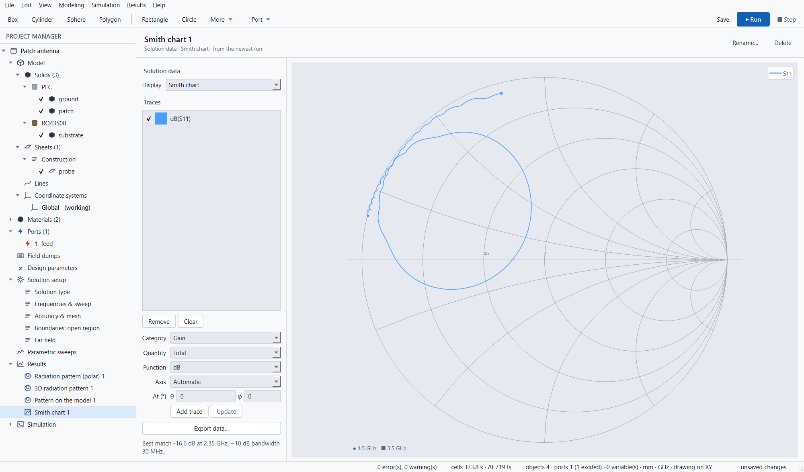 |
| Wilkinson divider | Smith chart |
| 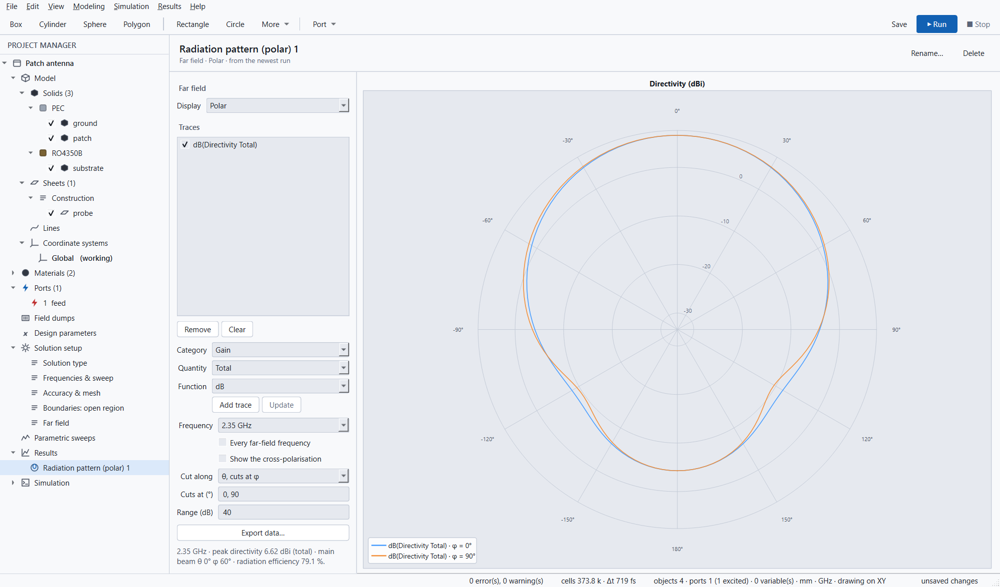 | 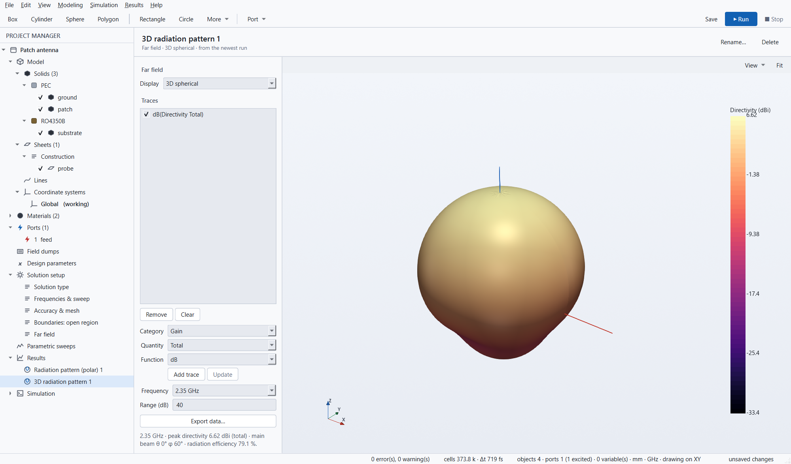 |
| Pattern cuts | 3D pattern |
| 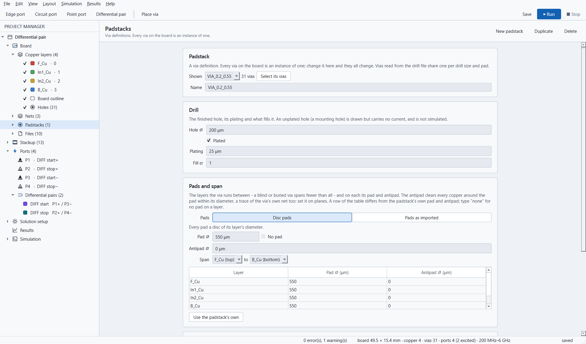 | 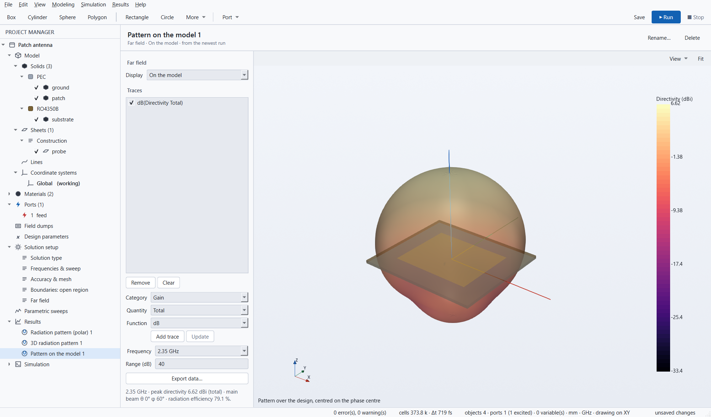 |
| Padstacks and vias | Pattern drawn over the model |

There are four themes under **View › Theme**, including a dark one.

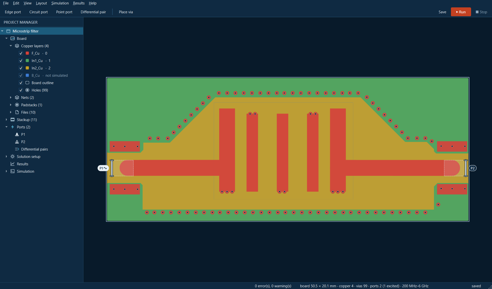

## Installing

There's no prebuilt download yet, so for now you run it from source.

### Fedora (and other Linux)

From the repo folder:

```bash
./gems.sh setup     # dnf packages, builds openEMS, makes .venv and installs everything
./gems.sh doctor    # checks the install and tells you what's missing
./gems.sh           # starts the app
./gems.sh desktop   # optional: adds EMShrimulator Studio to the app menu
```

openEMS isn't packaged for Fedora, so `setup` compiles it from source:

- It installs the build tools and libraries with `sudo dnf install`, so it asks
  for your password once. These are gcc, cmake, boost, tinyxml, hdf5, CGAL,
  VTK and `python3.13`. Set `GEMS_SKIP_DNF=1` to skip this step and install
  them yourself.
- It clones [openEMS-Project](https://github.com/thliebig/openEMS-Project)
  `v0.37.0` into `.cache/`, builds fparser, CSXCAD and openEMS without the
  AppCSXCAD GUI, and installs them into `~/opt/openEMS`. This takes 10–30
  minutes. Set `OPENEMS_DIR` to use a different prefix or an openEMS you
  already built, and `GEMS_OPENEMS_REF` to build a different tag.
- It compiles the CSXCAD and openEMS Python bindings against the venv's
  Python. The venv uses Python 3.13; set `GEMS_PYTHON` to use another one.

`./gems.sh openems` rebuilds just openEMS and its bindings, and
`./gems.sh setup --force` recreates the venv from scratch. A `.venv` left over
from Windows is replaced automatically.

After a Fedora upgrade, openEMS can stop loading with an error like
`libhdf5.so.310: cannot open shared object file`. The upgrade replaced a
library it was built against (Fedora 45 moved HDF5 from 1.14 to 2.x).
`./gems.sh doctor` reports this, and `./gems.sh setup` notices it and rebuilds
openEMS and its bindings against the new libraries.

On a Wayland desktop the app runs through XWayland (`QT_QPA_PLATFORM=xcb`),
because VTK's 3D viewport needs an X11 window. To override that, set
`QT_QPA_PLATFORM` yourself.

### Windows

You need:

- **Python 3.13**, exactly (`winget install Python.Python.3.13`). The openEMS
  wheels are only built for 3.13.
- **openEMS for Windows** from the
  [openEMS-Project releases](https://github.com/thliebig/openEMS-Project/releases).
  Get a build with `cp313` wheels in its `python` folder. Unzip it to
  `C:\OpenEMS\openEMS`, or set `OPENEMS_DIR` to whatever folder has
  `openEMS.exe` in it.

Then in PowerShell, from the repo folder:

```powershell
.\gems.ps1 setup    # makes .venv and installs everything, openEMS wheels included
.\gems.ps1 doctor   # checks the install and tells you what's missing
.\gems.ps1          # starts the app
```

You can also double-click `EMShrimulator Studio.bat`.

### Either way

When you run from source, projects go in `projects/` inside the repo.
`./gems.sh test` (or `.\gems.ps1 test`) runs the tests, and `build` makes the
standalone bundle in `dist/`: a `.tar.gz` on Linux, a `.zip` on Windows.

## First run

1. **File › New project** (Ctrl+N) and pick a template.
2. **Run** (F5). Progress shows in the status bar, and the solver log is under
   **Simulation** in the project tree.
3. Open **Results**, or make your own plot with **Results › New report**.

| | |
| --- | --- |
| 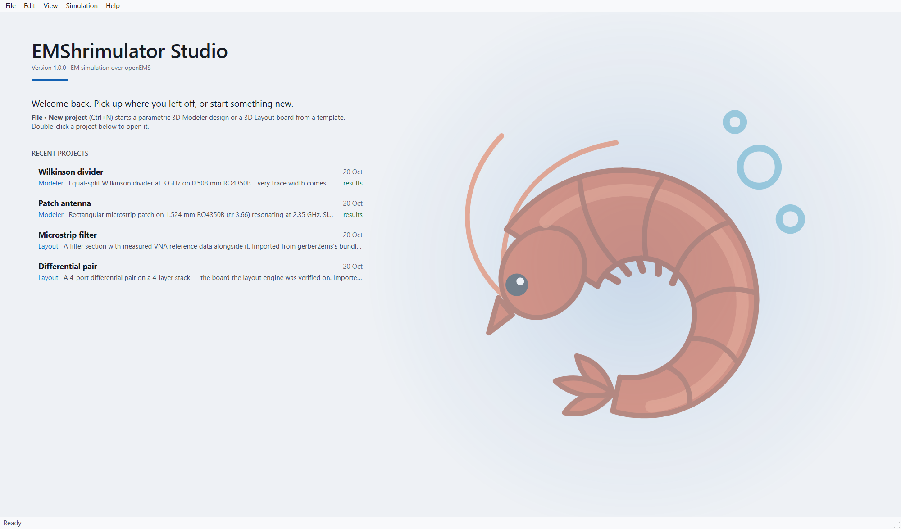 | 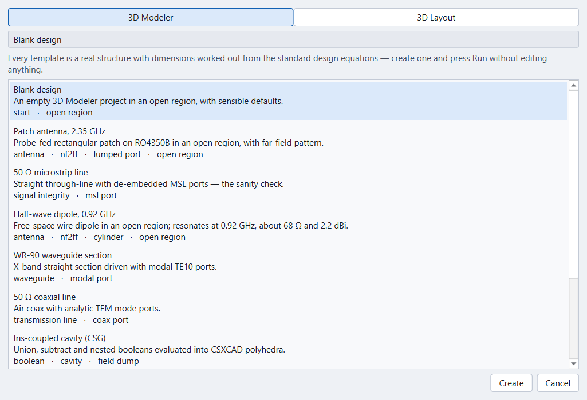 |
| Start page | New project from a template |
| 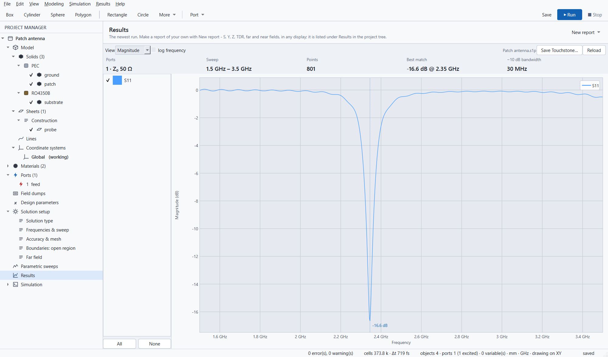 | |
| Results after a run | |

## Good to know

- It runs on Fedora and Windows. Other Linux distributions should work if you
  install the equivalent packages and run `GEMS_SKIP_DNF=1 ./gems.sh setup`.
- FDTD is hungry. A big board or a fine mesh eats memory, disk and time.
- It's a simulator. The answer is only as good as the mesh, boundaries,
  materials and ports you give it, so sanity-check results before you trust
  them with a board spin.

## Where things are

| Folder | What's in it |
| --- | --- |
| `EMShrimulator/core` | The engine: projects, geometry, meshing, solver runs, results. No Qt. |
| `EMShrimulator/app` | The Qt desktop app |
| `vendor/gerber2ems-main` | The patched gerber2ems used by the 3D Layout |
| `tests` | Tests, see [`tests/README.md`](tests/README.md) |
| `packaging` | PyInstaller spec and the release build script |
| `docs` | [How it works](docs/how-it-works.md), and the screenshots |

## Bugs

Please open an issue. If a run gives a wrong answer, attach the project
(**File › Export project…**), it makes it much easier to track down. For
security problems, see [`SECURITY.md`](SECURITY.md).

## License

Copyright (C) 2026 Shriii1389. GPL-3.0-or-later, see [`LICENSE`](LICENSE).

The bundled gerber2ems keeps its Apache-2.0 license, and openEMS and CSXCAD
belong to their authors. [`THIRD_PARTY_NOTICES.md`](THIRD_PARTY_NOTICES.md)
lists everything that's bundled.
